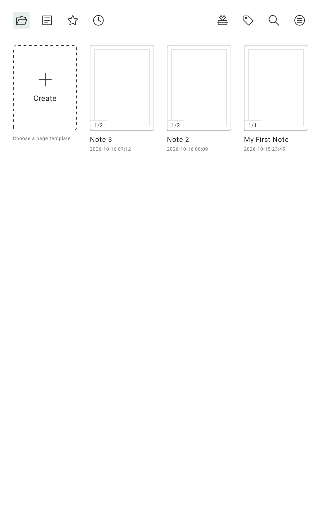
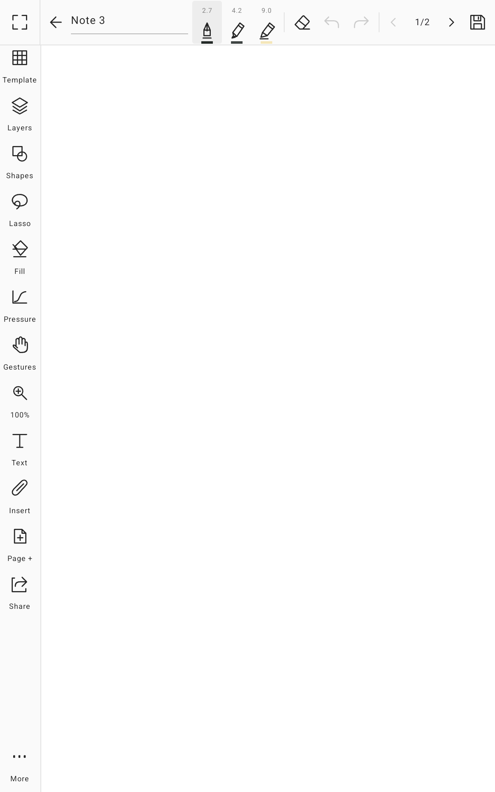
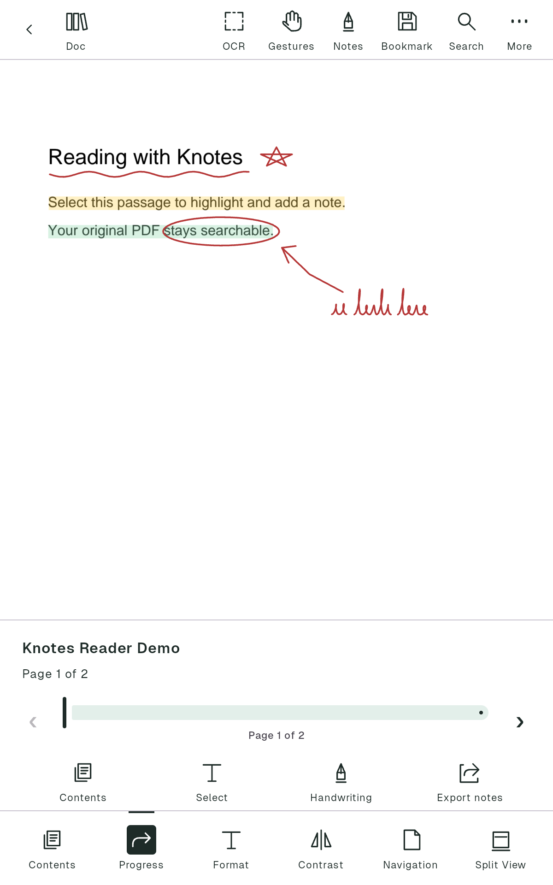

<p align="center">
  
</p>

<h1 align="center">Folio</h1>

<p align="center"><strong>Handwritten notes and a PDF &amp; EPUB reader for Android</strong></p>

<p align="center">
  Write with pressure-sensitive brushes, sketch on an infinite canvas and annotate your books.<br>
  No account and no ads. Your notes stay on your device.
</p>

<table>
  <tr>
    <td width="33%"></td>
    <td width="33%"></td>
    <td width="33%"></td>
  </tr>
  <tr>
    <td align="center">Library</td>
    <td align="center">Notebook</td>
    <td align="center">Reader</td>
  </tr>
</table>

## Why Folio

Folio is made for people who think with a pen. It feels like paper, opens instantly and keeps everything on your tablet or phone. You don't sign up, nothing syncs behind your back, and your notes are saved in an open format you can always take with you.

## Features

**Write naturally**
- Twelve brushes: ballpoint, fineliner, gel pen, marker, fountain pen, brush pen, calligraphy, highlighter, 2H–6B pencils, chalk, spray and a bristle paint brush.
- Low-latency ink with pressure and tilt, and pressure curves you can shape yourself.
- A pressure threshold that ignores a hovering or worn pen tip.

**Pages, or no edges at all**
- 35 page templates, from lined and Cornell to planners, Kanban and music staff.
- Swipe the page left or right to turn it, with a smooth slide and a visible page edge. On the last page, swipe left and release to add a page (or tap **+** in the top bar); you can also pull up past it and hold. Page+ shows each paper as a card. Nothing is added by accident.
- In the page manager, tap **Select** (or long-press a page) to delete several pages at once.
- Open a PDF or EPUB as a notebook (**+ → Import PDF/EPUB as notebook**) to write on its pages. A PDF page becomes a picture; an EPUB becomes pages of typed text (images and styling are left out), each chapter starting on a new page.
- An infinite canvas with pins and a minimap.
- Layers, lasso, shapes, fill, text, tables, stickers, sticky notes, images, a ruler, a zoom window and voice notes.

**Handwriting to text**
- Select handwriting with the lasso → **Convert to text** to turn it into a typed text box, in 300+ languages, on your device.
- Write with the pen straight into any text field (Android 14+ with Gboard's stylus handwriting).

**Live boards for calls**
- A **Live** tab with whiteboards built on [Excalidraw](https://excalidraw.com), written with your pen and Folio's pressure settings.
- Start a live session and share a link: people in your call watch and draw from any browser.
- Palm rejection, and export as an image or an Excalidraw file.

**Read with a pen in hand**
- Open PDF and EPUB books, from the library or from other apps.
- Optional folder mosaics with note, canvas and book previews: folder options → Edit folder → Mosaic.
- Write on PDF pages with the notebook's pens (fountain pen, pencil, highlighter, chalk and more, with pressure). The toolbar matches the notebook's, and your pens are shared between both.
- Highlight, underline, add notes and bookmarks. Long-press a word (finger or stylus) to select it and drag the large handles to extend; the selection toolbar is one small row you can drag out of the way.
- 11 highlight colours plus a custom colour picker. Long-press a word inside a saved mark, then tap the palette button to change its type or colour (with a live preview) or delete it.
- Adjust PDF text weight, sharpness, pale backgrounds and dark tones; keep time, battery and reading position in view.
- Search, browse expandable chapters and subchapters, jump to any page and recognize text in scanned pages, all on the device.
- Browser-style open-book tabs that keep their order; the tab menu switches, closes other tabs or hides the bar (bring it back from **More → Show book tabs**). Customize reading gestures.
- Study view: a book and a notebook side by side.
- Export the annotated PDF, or your reading notes as Markdown.

**A tidy library**
- Folders with colours and styles, favourites, recent items and search across names, typed text, tags and book titles.
- Recent-note tabs for quick switching that keep their order, with the same tab menu and a show/hide option in the editor’s More menu.
- A Trash that keeps deleted items for 7 or 30 days.
- Smart backups to a folder you choose, with daily, weekly and monthly versions.
- Export pages as PDF or PNG, or a notebook as an editable `.folio` file.

## Privacy

Folio works offline and your notes and books never leave your device. There is no account and no advertising. Folio shares anonymous usage statistics (which screens and features are used, never your content) through Google Analytics; you can turn this off in Preferences, and users in the EU, UK and Switzerland are asked first. The microphone is used only when you record a voice note. Read the full [privacy policy](apps/docs/src/pages/privacy.astro).

## Get Folio

Folio is coming to Google Play for Android phones and tablets. Until then you can build it from source.

### Build from source

You need [Bun](https://bun.sh) 1.4.4 or later, JDK 21 and the Android SDK (or Android Studio).

```bash
git clone https://github.com/allient/folio.git
cd folio
bun install

just install-debug      # build and install on a connected device or emulator
just docs               # run the website locally at http://localhost:4321
```

Run `just` to list every task. To work on the app, open `apps/mobile` in Android Studio.

## Project layout

| Folder | What's inside |
|---|---|
| [`apps/mobile`](apps/mobile) | The app: Kotlin Multiplatform with Jetpack Compose. Android ships today; the shared code is ready for a future iPad version. |
| [`apps/docs`](apps/docs) | The website: landing page, privacy policy and developer documentation (Astro). |
| [`packages/brand`](packages/brand) | The Folio brand kit: logo, icons, colours and guide. |

## Contributing

Bug reports and ideas are welcome in [Issues](https://github.com/allient/folio/issues). Before you send code, read [AGENTS.md](AGENTS.md). It has the architecture, coding standards, test commands and release process. The developer documentation is in [`docs/`](docs), including the [Google Play publishing guide](docs/publishing/google-play.md).

## Roadmap

- Release on Google Play
- Dark theme and more appearance options
- Spanish and other languages
- Handwriting recognition and search inside handwritten notes
- Nested folders
- Encrypted backups and optional sync
- An iPad version

## Credits

Folio is an independent project and isn't affiliated with the apps that inspired it: [BOOX](https://www.boox.com) Notes and NeoReader, [XPPen Notes](https://www.xp-pen.com) and [Infinite Painter](https://www.infinitestudio.art). Thank you to their teams. Folio's code, icons and artwork are its own.

Built with [Jetpack Ink](https://developer.android.com/jetpack/androidx/releases/ink), [Compose Multiplatform](https://www.jetbrains.com/compose-multiplatform/), [Readium](https://readium.org), [PdfiumAndroid](https://github.com/barteksc/PdfiumAndroid), [PdfBox-Android](https://github.com/TomRoush/PdfBox-Android), [ML Kit](https://developers.google.com/ml-kit) and [zstd-jni](https://github.com/luben/zstd-jni). The typeface is [Geist](https://vercel.com/font).

## License

Apache License 2.0. See [LICENSE](LICENSE).

PDF reader Format controls include scrolling or single pages, LTR/RTL navigation, zoom,
fit modes, adjustable marquee crop with Apply/Cancel, margins and text enhancement.
Reader display settings persist when you close and reopen the reader. While cropped, only
Marquee Crop and Reset appear in the Crop row; Reset restores the fit controls.

Reader Split View supports the current document, another PDF/EPUB, handwritten study notes
or text notes, with side-by-side or stacked panes and saved landscape orientation controls.

In the PDF reader, **Handwriting** opens a floating drawing bar with the same pens as your notebooks: tap a pen to write, tap it again for its settings (type, size, colour, pressure), and long-press to reorder. Pens you add or change are shared with the notebook editor. The hand pans and zooms the page without closing the bar; there's also the eraser (single strokes or the whole page), undo/redo, Bookmark page, Select text and More.

In the PDF reader, hold a word and drag to select text, then drag either selection handle to adjust the passage. The selection toolbar offers highlight colors, solid/dashed/wavy underlines, notes, copy, share and Remove marks. Long-press an existing mark to edit its color or delete it. Scanned pages need OCR first.

Reader Normal mode has neither fit control selected. Fit Screen and Fit Width detect the
visible PDF content on a worker and trim blank margins (including scanned pages). Fit Screen
fits that content within the viewport; Fit Width fills its width. Reset clears fitting and
manual crop and returns to Normal. Reset Zoom clears zoom while retaining crop/fit settings.
