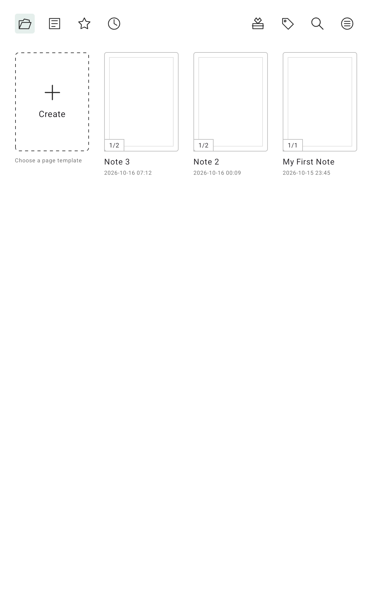

# Folio

**Folio: Handwritten Notes & eReader**

Folio is a **Kotlin Multiplatform** app for handwritten notes, infinite canvases and reading PDF and EPUB books with a pen tablet. It is local first: no account, no cloud sync and no internet permission. Your notebooks stay on the device, with automatic backups to a folder you choose. The only runtime permission is `RECORD_AUDIO`, for voice notes.

- **Store title:** Folio: Handwritten Notes & eReader.
- **Application ID and Kotlin packages:** `com.allient.folio`.
- **Kotlin Multiplatform:** the Gradle project in `apps/mobile` has an Android app, a `shared` module with Compose Multiplatform UI and models, and an iOS app. Android is the complete app today; iOS still shows the starter screen (see [Platforms](#platforms)).
- **Tested on:** an Android tablet emulator (API 36, 1200×1920) and an XPPen MagicNotePad MNP1095 (Android 14).



## Features

### Library

- One home for notebooks and books. A tab control filters **All**, **Notes** (paged notebooks), **Canvas** (infinite canvases) and **Books** (PDF and EPUB from the reader).
- Content is grouped in **Folders**, **Notes**, **Canvas** and **Books** sections; long sections fold to one row with **Unfold (n)** / **Fold**.
- Grid or list view, and sort by last edit, date created, file type or name. Both are remembered.
- Sidebar (a drawer on phones and portrait tablets, a side panel from 720 dp): Notes, Folders (create and open), Recent, Favorites, Trash bin, Preferences and About.
- The **+** button creates a notebook or infinite canvas, a folder, or imports a book or a notebook backup.
- **Select** mode: move, favorite or delete several items at once.
- Search across names, typed text, tags and outlines, plus book titles and authors. Tag search is in the ⋮ menu.
- Notebook details (▾ or long press): open, rename, copy, delete, move, favorite, share (PDF, PNG or backup). Books: open, move, favorite, delete.
- Folders with 6 colors (sage, blue, lavender, rose, peach, sand) and 4 styles (Classic, With papers, Tabbed, Open). Folders are one level deep.
- **Trash:** deleted notebooks, folders and books go to the Trash bin, where they can be restored or deleted permanently. Items are deleted automatically after 7 or 30 days (or never), checked when the app starts. A deleted folder keeps its contents in the library, unfiled, until it is restored. See [local storage](apps/docs/src/content/docs/architecture/local-storage.md#trash).
- **Preferences:** accent colour (Sage, Morning, Evening, Sea, Forest, Lavender, Desert, Graphite), corners (Sharp, Rounded, Soft), default view and sort, start notebooks in focus mode, Trash retention, and a link to backup settings. The accent and corners apply to the library screens only; the editor keeps its own colours. There is no dark theme, because the editor uses fixed light colours.
- 35 page templates in General, Planning, Work, Study, Creative and Custom, such as lined, grid, dots, Cornell, Kanban, music staff and habit tracker.

### Canvas

- **Pages:** fixed 600×960 document units, shown as single pages or a continuous scroll.
- **Infinite canvas:** chosen when the notebook is created and fixed after that. Includes pins, a minimap with the viewport, tap-to-jump and "Back to content".
- Zoom, pan and focus mode.
- Up to 6 layers.
- Undo and redo up to 80 steps (in memory only).

### Brushes and pressure

| Brushes | Renderer |
|---|---|
| Pen, Fineliner, Gel pen, Marker, Fountain pen, Brush pen, Calligraphy, Highlighter | [Jetpack Ink](https://developer.android.com/jetpack/androidx/releases/ink) (`JetpackInkEngine`), with low-latency wet ink through `InProgressStrokesView` |
| Pencil (2H–6B), Chalk, Spray, Paint brush | `NaturalMediaRenderer`, paper grain anchored to the document |

- Presets in `BrushCatalog.kt`, such as Pencil HB, Ballpoint Fine, Calligraphy Italic 35° and Highlighter Wide.
- Pressure profiles Soft, Balanced and Firm, or a custom curve with an activation threshold and two Bézier control points (`DrawingProfiles.kt`). Pressure below the threshold ends the stroke segment; this filters hovering and worn stylus tips.
- Brush widths can be shown in millimetres, based on the screen's DPI.

### Editing tools

- Erasers: partial (vector cut), whole stroke and lasso, with size and layer scope. The pen's hardware eraser end works too.
- Lasso (freeform or rectangle): move, copy, paste, duplicate, cut, recolor, rotate, resize, flip, tag and delete.
- 10 shapes, and fill for closed paths.
- Text boxes, timestamps, links to notes and web links.
- Images, attachments and audio recording.
- Tags and page outlines.
- A floating toolbox with customizable tool sets: Default, Meeting, Sketching, Journaling, or your own.

### Saving, export and backup

- Autosave: a background queue saves the latest state. A retry button appears only if a save fails.
- Export all pages as PDF, or the current page as PNG (1200×1920).
- `.knotes` backups of one notebook or the whole library, editable after import.
- Smart backups (optional) to a folder you pick: a library backup about 2 minutes after you close a note, close a book or leave the app, and at most every 15 minutes during long sessions. Nothing is written when nothing changed. Each copy is verified before older ones are removed. Folio keeps the 5 most recent backups plus the newest of each of the last 7 days, 4 weeks and 6 months (at most 22 files), skips a backup when free space is low, and leaves other files in the folder alone. PDF and EPUB originals are not copied; their titles, positions, highlights and notes are. Settings lists the kept versions; restoring one merges it into the library and never erases anything.
- Import PDF pages into a notebook as page backgrounds (1–200 pages).

### Reader

- **PDF** (PDFium): swipe pages, jump to a page, zoom up to 4×, select text, highlight, underline, draw, add notes and bookmarks, search, run on-device OCR (ML Kit, Latin script), and export the annotated PDF (PDFBox).
- **EPUB** (Readium): highlights, notes, bookmarks, font size, line spacing, paged or continuous mode, and light, sepia or dark themes. Books with DRM are rejected.
- Study split view: a book and a notebook side by side.
- Export reading notes as Markdown.
- Opens PDF and EPUB files from other apps ("Open with").

Details: [reader.md](apps/docs/src/content/docs/architecture/reader.md).

## Repository structure

A monorepo managed with [Bun](https://bun.sh) workspaces and [Turborepo](https://turborepo.com), laid out like [Better-T-Stack](https://better-t-stack.dev): apps in `apps/`, shared packages in `packages/`.

```
folio/
├── apps/
│   ├── mobile/                     Kotlin Multiplatform app (Gradle project root)
│   │   ├── androidApp/             Android app: almost all app logic
│   │   │   └── src/main/kotlin/com/allient/folio/
│   │   │       ├── MainActivity.kt         Launcher; handles PDF/EPUB "Open with"
│   │   │       ├── ReaderActivity.kt       PDF/EPUB reader
│   │   │       ├── NotebookEditor.kt       Notebook editor UI
│   │   │       ├── NotebookViewModel.kt    Editor state, autosave queue
│   │   │       ├── InkCanvasView.kt        Drawing canvas, input, erasers, lasso
│   │   │       ├── JetpackInkEngine.kt     Jetpack Ink geometry and rendering
│   │   │       ├── FrontBufferedInkController.kt  Low-latency wet ink
│   │   │       ├── NaturalMediaRenderer.kt Pencil, Chalk, Spray, Paint brush
│   │   │       ├── NotebookStorage.kt      SQLite storage
│   │   │       ├── NotebookFiles.kt, LocalBackup.kt  Export, import, backup
│   │   │       └── PdfReaderEngine.kt, EpubReaderEngine.kt, ReaderStore.kt
│   │   ├── shared/                 Kotlin Multiplatform library: Compose Multiplatform home,
│   │   │                           folder editor, backup settings, templates, reader models
│   │   ├── iosApp/                 Xcode project (starter shell)
│   │   └── artifacts/              Demo PDF/EPUB files, reader captures, local builds
│   └── docs/                       Documentation site (Astro Starlight, runs on Bun)
│       └── src/content/docs/       Architecture, features, investigations, roadmap, testing
├── packages/
│   └── brand/                      Brand kit v1.0: logo, icons, Android launcher resources, guide
├── .argent/flows/                  Recorded UI automation flows
├── package.json, turbo.json        Workspace and task pipeline
└── bun.lock
```

## Tech stack

| Item | Version |
|---|---|
| Kotlin | 2.4.20 |
| Android Gradle Plugin | 9.1.1 |
| Gradle | 9.5.1 (JDK 21 toolchain) |
| Compose Multiplatform | 1.12.1 |
| Android SDK | minSdk 25, targetSdk and compileSdk 37 |
| Jetpack Ink | 1.1.0-alpha09 (authoring, brush, strokes, rendering) |
| PDF | pdfium-android 2.0.3, pdfbox-android 2.0.27.0 |
| EPUB | Readium 3.4.0 |
| OCR | ML Kit text recognition 16.0.1 |
| Other | zstd-jni, WorkManager, ExifInterface |

Storage uses plain `SQLiteOpenHelper` and `org.json`, with no Room or SQLDelight.

## Data and file formats

- `knotes.db`: tables `notebooks`, `pages` and `settings`, schema v1, with notebooks stored as JSON (version 2).
- `knotes-reader.db`: reader documents and annotations (WAL, foreign keys).
- Media is stored in the app's private `files/media/` folder. Android's cloud backup is off (`allowBackup="false"`), and nothing is encrypted yet.
- `.knotes` files are ZIP archives with a `manifest.json` and Zstandard-compressed JSON. Stroke engines are versioned (`jetpack-ink-v1`, `jetpack-ink-v2`, `shape-v1`, `fill-cut-v1`), so old ink still renders the same way.

Details: [local storage](apps/docs/src/content/docs/architecture/local-storage.md), [portable format](apps/docs/src/content/docs/architecture/portable-format.md), [SQLite migrations](apps/docs/src/content/docs/architecture/sqlite-migrations.md), and the [JSON schemas](apps/docs/public/schemas).

## Build and run

Requires Bun 1.4+, plus Android Studio or the Android SDK and JDK 21. Open `apps/mobile` in Android Studio.

```bash
bun install              # once, at the repository root

bun run dev:docs         # docs site at http://localhost:4321
bun run build:docs       # static site in apps/docs/dist
bun run build:android    # debug APK (runs Gradle in apps/mobile)
bun run test:android     # shared module host tests
bun run build            # everything
```

A [`justfile`](justfile) wraps the common tasks (`just` lists them):

```bash
just docs                     # docs dev server
just install-debug            # build + install debug APK on emulator-5554
just install-release <serial> # build, sign (local debug key) and install release APK
just crashlog <serial>        # error and crash log
just vibe                     # zellij session with the vibe layout
```

Set `FOLIO_TABLET=<adb serial>` in your shell to make the tablet the default for `install-release` and `crashlog`.

Gradle can also be run directly from `apps/mobile`:

```bash
cd apps/mobile
# Debug build
./gradlew :androidApp:assembleDebug

# Install on a connected device or emulator
./gradlew :androidApp:installDebug

# Release build (unsigned; sign it before installing)
./gradlew :androidApp:assembleRelease

# Lint
./gradlew :androidApp:lintDebug
```

With more than one device connected, pass the serial to adb: `adb -s <serial> install -r <apk>`.

## Tests

```bash
# Instrumented tests (needs a device or emulator)
./gradlew :androidApp:connectedDebugAndroidTest
```

| Test class | What it covers |
|---|---|
| `InkCanvasViewTest` | Drawing, pressure, erasers, lasso, shapes, zoom |
| `NotebookStorageTest` | SQLite storage and migrations |
| `NotebookFilesTest` | Export, import, backups |
| `LocalBackupTest` | Smart backups: version retention, pruning only the app's own files, archive verification, unchanged-library skip, low free space, no reader originals |
| `ReaderTest` | PDF and EPUB reader |
| `NaturalBrushTest` | Pencil, Chalk, Spray |
| `TrashTest` | Trash: soft delete, restore, permanent delete, retention purge, folders, backups; home preferences |

`gradle.properties` keeps test APKs installed after a run, so data on the device isn't wiped. The `shared` module's tests (`:shared:testAndroidHostTest`, `:shared:iosSimulatorArm64Test`) are still template placeholders. Results and UI flow replays are in [validation.md](apps/docs/src/content/docs/testing/validation.md).

## Platforms

Only Android is implemented. `iosApp` builds the `Shared` framework but shows the Kotlin Multiplatform starter screen (`App.kt`). The library screen, storage, ink and reader are not wired up on iOS.

## Inspiration and credits

Folio is an independent project and is not affiliated with these companies or apps. They inspired parts of its design, and we thank their teams:

- **[BOOX](https://www.boox.com) Notes and NeoReader** (Onyx International): the compact top toolbar, the vertical tool rail, the white writing surface and the split view for reading next to a notebook.
- **[XPPen Notes](https://www.xp-pen.com)** (XPPen): the library home with All / Notes / Canvas / Books, the sidebar and the preferences layout.
- **[Infinite Painter](https://www.infinitestudio.art)** (Infinite Studio): the pressure, velocity and tilt response curves and their presets.

Folio's code, icons and artwork are its own. No screenshots, assets or code from these apps are included in this repository.

Built with open-source libraries, among them [Jetpack Ink](https://developer.android.com/jetpack/androidx/releases/ink), [Compose Multiplatform](https://www.jetbrains.com/compose-multiplatform/), [Readium](https://readium.org), [PdfiumAndroid](https://github.com/barteksc/PdfiumAndroid), [PdfBox-Android](https://github.com/TomRoush/PdfBox-Android), [ML Kit](https://developers.google.com/ml-kit) and [zstd-jni](https://github.com/luben/zstd-jni). The docs site uses [Astro Starlight](https://starlight.astro.build); the monorepo uses [Bun](https://bun.sh) and [Turborepo](https://turborepo.com). The interface typeface is [Geist](https://vercel.com/font) (SIL Open Font License).

## Known issues and limits

- **Jetpack Ink mesh crash on Android 14:** Ink's default mesh rendering crashed on the MNP1095 tablet. Finished strokes are now forced to path rendering; keep `forcePathRendering = true` when upgrading Ink. Wet ink still uses mesh on API 34+. See [mnp1095-mesh-crash.md](apps/docs/src/content/docs/investigations/mnp1095-mesh-crash.md).
- Jetpack Ink is an alpha dependency.
- Undo history is lost when the app restarts.
- Unused media files are never cleaned up.
- Exports are fixed at 1200×1920.
- PDF pages imported into a notebook become images.
- Audio is not synced with ink, and recording stops in the background.
- Backups are not encrypted.
- Not implemented: handwriting recognition, shape recognition, nested folders, cloud sync, and importing BOOX `.note` files. See [To do](#to-do).
- Reader limits (password-protected PDFs, OCR scripts, PDF outline and more): see [reader.md](apps/docs/src/content/docs/architecture/reader.md).

## To do

**App**
- [ ] Dark, light and OLED themes, plus colour mode, contrast and style options ([plan](apps/docs/src/content/docs/roadmap/planned-preferences.md))
- [ ] Multi-language UI, starting with Spanish ([plan](apps/docs/src/content/docs/roadmap/planned-preferences.md#multi-language-pending))
- [ ] iOS app: wire the shared library screen, storage, ink and reader
- [ ] Handwriting recognition (search inside handwritten notes) and shape recognition
- [ ] Nested folders
- [ ] Encrypted backups and optional cloud sync
- [ ] Keep undo history after the app restarts
- [ ] Clean up unused media files
- [ ] Export at other resolutions than 1200×1920; keep imported PDF pages as vectors
- [ ] Sync audio recordings with ink; keep recording in the background
- [ ] Filter accidental micro-taps from worn styluses

**Release**
- [ ] Create the release signing key (kept outside the repository)
- [ ] Play Store listing: screenshots, description, privacy policy
- [ ] Set the final iOS bundle ID
- [ ] Publish the docs site (GitHub Pages or Vercel)
- [ ] Refresh the screenshots in the README and docs with the new home design

**Upstream**
- [ ] Report the Jetpack Ink mesh crash on Android 14 to Google ([analysis](apps/docs/src/content/docs/investigations/mnp1095-mesh-crash.md))

## Publishing

Planned store listing:

| Field | Value |
|---|---|
| Store title | Folio: Handwritten Notes & eReader |
| App name (launcher) | Folio |
| Application ID | `com.allient.folio` |

Test builds from before 2026-10-19 used the starter ID `com.example.knotes` and install as a separate app; export a `.knotes` backup from them if needed, import it into Folio, then uninstall them.

Before the first store release:

1. Create the release signing key and keep it outside the repository (`*.jks` is git-ignored). Losing it means the store app can never be updated.
2. Set `PRODUCT_BUNDLE_IDENTIFIER` in `apps/mobile/iosApp/Configuration/Config.xcconfig` to the final iOS bundle ID when the iOS app ships.

Unchanged on purpose: the `.knotes` backup extension and its format ID (`application/vnd.knotes.archive+zip`), and the database file names (`knotes.db`, `knotes-reader.db`). Renaming them would break existing backups and data.

## Documentation

The documentation lives in the Starlight site (`apps/docs`); run `bun run dev:docs` to browse it.

| Document | Topic |
|---|---|
| [boox-feature-coverage.md](apps/docs/src/content/docs/features/boox-feature-coverage.md) | Feature comparison with BOOX Notes (partly out of date: brushes and infinite canvas have since been added) |
| [canvas-tools-review.md](apps/docs/src/content/docs/features/canvas-tools-review.md) | Erasers, lasso, shapes and fill review |
| [ink-rendering-research.md](apps/docs/src/content/docs/architecture/ink-rendering-research.md) | Rendering performance research and the Jetpack Ink plan |
| [jetpack-ink-implementation.md](apps/docs/src/content/docs/architecture/jetpack-ink-implementation.md) | Jetpack Ink integration notes |
| [mnp1095-mesh-crash.md](apps/docs/src/content/docs/investigations/mnp1095-mesh-crash.md) | Android 14 mesh rendering crash: analysis and fix |
| [local-storage.md](apps/docs/src/content/docs/architecture/local-storage.md) | On-device storage, backup and import limits |
| [portable-format.md](apps/docs/src/content/docs/architecture/portable-format.md) | `.knotes` archive format |
| [sqlite-migrations.md](apps/docs/src/content/docs/architecture/sqlite-migrations.md) | Database migration rules |
| [reader.md](apps/docs/src/content/docs/architecture/reader.md) | PDF and EPUB reader |
| [validation.md](apps/docs/src/content/docs/testing/validation.md) | Test results and UI flow replays |
| [planned-preferences.md](apps/docs/src/content/docs/roadmap/planned-preferences.md) | Pending: dark/light theme, colour options, multi-language |
| [brand.md](apps/docs/src/content/docs/brand.md) | Brand kit: logo system, colours, type and where the app uses them |
