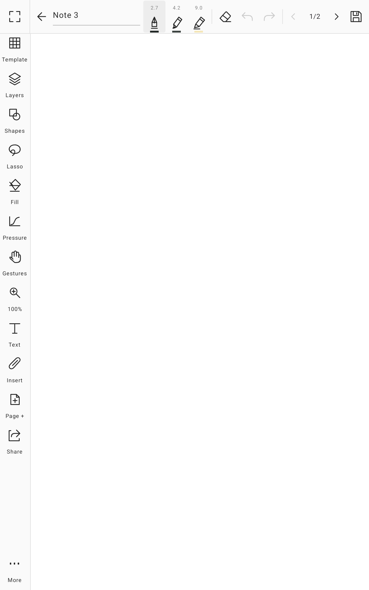
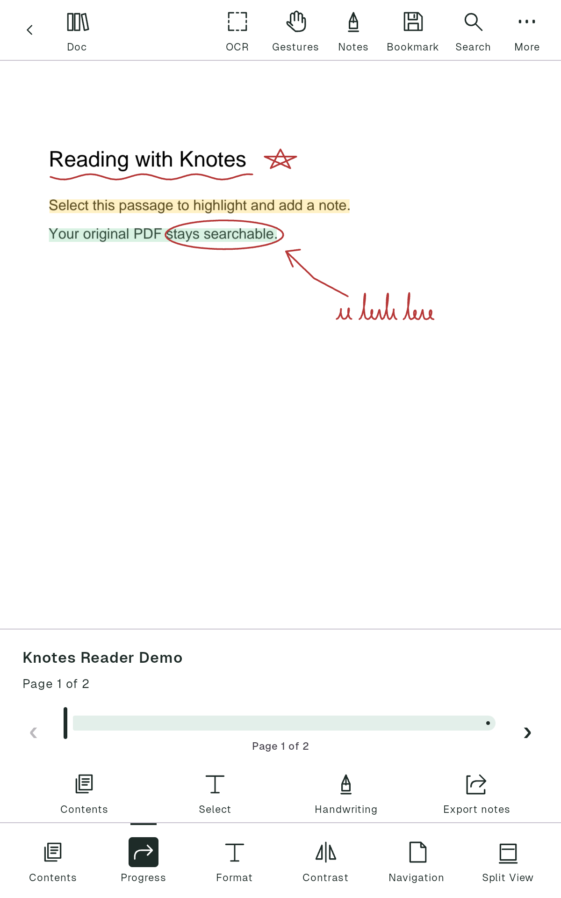

<p align="center">
  
</p>

<h1 align="center">Folio</h1>

<p align="center"><strong>Handwritten notes and a PDF &amp; EPUB reader for Android</strong></p>

<p align="center">
  Write with pressure-sensitive brushes, sketch on an infinite canvas and annotate your books.<br>
  No account and no ads. Your notes stay on your device.
</p>

<table>
  <tr>
    <td width="33%"></td>
    <td width="33%"></td>
    <td width="33%"></td>
  </tr>
  <tr>
    <td align="center">Library</td>
    <td align="center">Notebook</td>
    <td align="center">Reader</td>
  </tr>
</table>

## Why Folio

Folio is made for people who think with a pen. It feels like paper, opens instantly and keeps everything on your tablet or phone. You don't sign up, nothing syncs behind your back, and your notes are saved in an open format you can always take with you.

## Features

**Write naturally**
- Twelve brushes: ballpoint, fineliner, gel pen, marker, fountain pen, brush pen, calligraphy, highlighter, 2H–6B pencils, chalk, spray and a bristle paint brush.
- Low-latency ink with pressure and tilt, and pressure curves you can shape yourself.
- A pressure threshold that ignores a hovering or worn pen tip.

**Pages, or no edges at all**
- 35 page templates, from lined and Cornell to planners, Kanban and music staff.
- An infinite canvas with pins and a minimap.
- Layers, lasso, shapes, fill, text, tables, stickers, sticky notes, images, a ruler, a zoom window and voice notes.

**Handwriting to text**
- Select handwriting with the lasso → **Convert to text** to turn it into a typed text box, in 300+ languages, on your device.
- Write with the pen straight into any text field (Android 14+ with Gboard's stylus handwriting).

**Live boards for calls**
- A **Live** tab with whiteboards built on [Excalidraw](https://excalidraw.com), written with your pen and Folio's pressure settings.
- Start a live session and share a link: people in your call watch and draw from any browser.
- Palm rejection, and export as an image or an Excalidraw file.

**Read with a pen in hand**
- Open PDF and EPUB books, from the library or from other apps.
- Highlight, underline, write in the margins, add notes and bookmarks.
- Search, jump to any page and recognize text in scanned pages, all on the device.
- Study view: a book and a notebook side by side.
- Export the annotated PDF, or your reading notes as Markdown.

**A tidy library**
- Folders with colours and styles, favourites, recent items and search across names, typed text, tags and book titles.
- A Trash that keeps deleted items for 7 or 30 days.
- Smart backups to a folder you choose, with daily, weekly and monthly versions.
- Export pages as PDF or PNG, or a notebook as an editable `.folio` file.

## Privacy

Folio works offline and your notes and books never leave your device. There is no account and no advertising. Folio shares anonymous usage statistics (which screens and features are used, never your content) through Google Analytics; you can turn this off in Preferences, and users in the EU, UK and Switzerland are asked first. The microphone is used only when you record a voice note. Read the full [privacy policy](apps/docs/src/pages/privacy.astro).

## Get Folio

Folio is coming to Google Play for Android phones and tablets. Until then you can build it from source.

### Build from source

You need [Bun](https://bun.sh) 1.4 or later, JDK 21 and the Android SDK (or Android Studio).

```bash
git clone https://github.com/allient/folio.git
cd folio
bun install

just install-debug      # build and install on a connected device or emulator
just docs               # run the website locally at http://localhost:4321
```

Run `just` to list every task. To work on the app, open `apps/mobile` in Android Studio.

## Project layout

| Folder | What's inside |
|---|---|
| [`apps/mobile`](apps/mobile) | The app: Kotlin Multiplatform with Jetpack Compose. Android ships today; the shared code is ready for a future iPad version. |
| [`apps/docs`](apps/docs) | The website: landing page, privacy policy and developer documentation (Astro). |
| [`packages/brand`](packages/brand) | The Folio brand kit: logo, icons, colours and guide. |

## Contributing

Bug reports and ideas are welcome in [Issues](https://github.com/allient/folio/issues). Before you send code, read [AGENTS.md](AGENTS.md). It has the architecture, coding standards, test commands and release process. The developer documentation is in [`docs/`](docs), including the [Google Play publishing guide](docs/publishing/google-play.md).

## Roadmap

- Release on Google Play
- Dark theme and more appearance options
- Spanish and other languages
- Handwriting recognition and search inside handwritten notes
- Nested folders
- Encrypted backups and optional sync
- An iPad version

## Credits

Folio is an independent project and isn't affiliated with the apps that inspired it: [BOOX](https://www.boox.com) Notes and NeoReader, [XPPen Notes](https://www.xp-pen.com) and [Infinite Painter](https://www.infinitestudio.art). Thank you to their teams. Folio's code, icons and artwork are its own.

Built with [Jetpack Ink](https://developer.android.com/jetpack/androidx/releases/ink), [Compose Multiplatform](https://www.jetbrains.com/compose-multiplatform/), [Readium](https://readium.org), [PdfiumAndroid](https://github.com/barteksc/PdfiumAndroid), [PdfBox-Android](https://github.com/TomRoush/PdfBox-Android), [ML Kit](https://developers.google.com/ml-kit) and [zstd-jni](https://github.com/luben/zstd-jni). The typeface is [Geist](https://vercel.com/font).

## License

Apache License 2.0. See [LICENSE](LICENSE).
