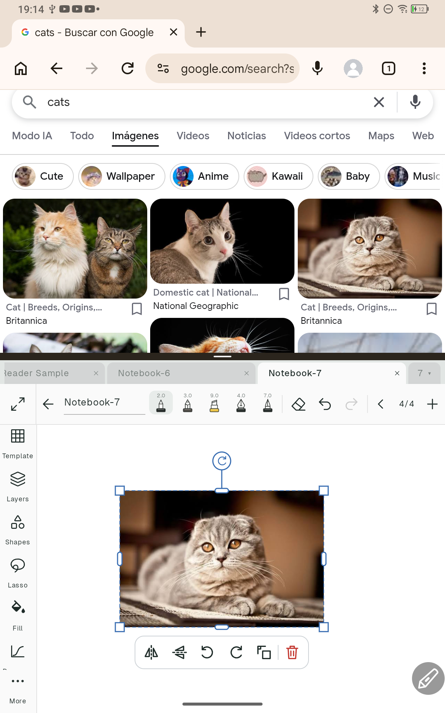

Adding and moving between pages should need no menu. This page describes what the editor does and where the code lives.

## Turning and adding pages

In **Single Page** layout the page follows your finger.

- **Swipe left or right** to turn the page. The next or previous page slides in beside it with a grey gutter and a thin edge line, so the page limits are easy to see. A short fast flick also turns the page.
- **On the last page**, swipe left. The new blank page slides in from the right with a **Swipe to add page** hint; past about a quarter of the screen it changes to **Release to add page** with a vibration. Let go and the same page finishes sliding in. Let go early and the page springs back.
- **With "Write with finger" on**, one finger writes, so use **two fingers** to swipe. With it off, one finger swipes.
- **The `+` button** in the top bar replaces the `›` arrow on the last page and adds a page at the end.
- **Page+** shows each paper (Blank, Ruled, Grid, Daily planner) as a card with a preview.

Writing never adds pages on its own.

How it works: `InkCanvasView.onPageDrag` reports the horizontal drag in screen coordinates (the page view itself moves, so local coordinates cannot measure it). `NotebookEditor` shifts the canvas with an `Animatable`, shows the neighbour from a full-quality snapshot (`PageSnapshots.kt`, same renderer, ink engine and image size as the real canvas, so nothing changes when the real page lands) and warms the shared image cache so the landing page never flashes blank.

## Page manager

Open it from the page counter. Cards are small (about four per row on a tablet). **Select** (or a long press on a page) switches to selection mode: tick pages, **Select all**, then **Delete** after a confirmation. A notebook always keeps at least one page.

## Drag images in from another app

With Folio and another app in split screen, long-press an image in the other app (Google Images in Chrome, Photos, Files) and drop it on a notebook page. It lands where you let go, at half the page width with its own proportions, and is selected right away so you can move, resize or rotate it. The drop goes through the same import as **Insert → Image**, so Folio keeps its own copy and Undo works. Drops are refused on a hidden or locked layer, and an app that drags only a link (no image file) is ignored. The PDF reader doesn't take drops yet.

In split screen a page keeps the shape it has full screen and scrolls (two fingers, the Pan tool, or one finger with finger drawing off) instead of being squashed into the smaller window.

Code: `InkCanvasView.handleImageDrag` (drop target), `NotebookViewModel.mergeEditorImport` (placement), `ViewUtils.isReducedWindow` and `InkCanvasView.documentAspect` (page shape in split screen).

## Import a PDF or EPUB as a notebook

**+ → Import PDF/EPUB as notebook** bypasses the reader.

| | PDF | EPUB |
|---|---|---|
| Result | One notebook page per PDF page, shown as a picture you write over | Pages of typed text; each chapter starts a new page |
| Kept | The page exactly as rendered (up to 1200×1920 px) | Text only, in a reading font |
| Left out | Selectable text and search | Images, fonts and layout |
| Limits | 1–200 pages, 128 MB | DRM books are rejected; at most 600 pages |

The EPUB conversion reads the spine, turns each document into paragraphs (`epubParagraphs`), wraps them with Android's `StaticLayout` and fills pages (`paginateChapterLines`). The two pure helpers live in `shared/commonMain` with tests. EPUBs stay readable in the reader, where you can highlight and annotate them.
