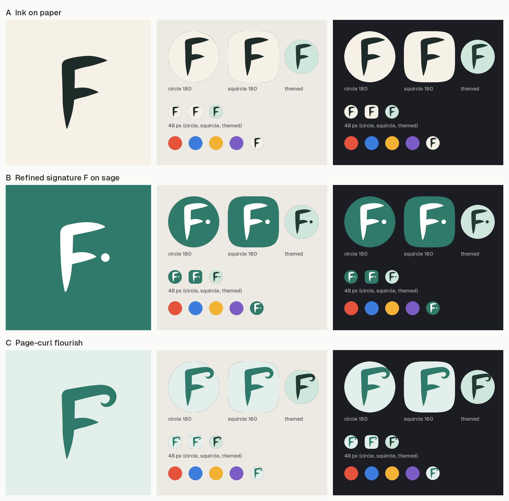

# Folio brand: logo and app icon

The selected Folio mark is a handwritten **F.** in white on sage. The refined B uses one continuous filled silhouette with a gently rising top stroke, an open middle stroke and a soft tapered stem. A round signature dot balances the right side. The same geometry can be exported to SVG, Android VectorDrawable and the Android 13 themed icon.

The refinement smooths the stroke joins, softens the pointed stem and aligns the slightly larger dot with the middle stroke. A and C remain the original exploratory concepts.



## Concepts

| | Concept | Colours | File |
|---|---|---|---|
| A | Ink F on warm paper, brush-pen style | ink `#1E2B28` on cream `#F6F1E6` | `concepts/folio-concept-a.svg` |
| **B (selected, refined)** | White signature F on the sage accent, with a round white dot after the middle stroke | white `#FFFFFF` on sage `#2F7A68` | `concepts/folio-concept-b.svg` |
| C | F whose top stroke curls under at the end, like a page corner turning | sage `#2F7A68` on soft sage `#E3EFEA` | `concepts/folio-concept-c.svg` |

**Why B:** it is the only concept that holds strong contrast on both light and dark wallpapers (A and C are pale tiles that fade into a light home screen), it uses the app's own Sage accent (`AccentPresets` in `HomeModels.kt`, `#2F7A68` / soft `#E3EFEA`), and the dot gives the F a distinct identity ("F." like a signed initial, or a nib touching the page) without adding small detail. At 48 px the F and dot both stay readable; the themed icon keeps the same silhouette.

To switch concepts, set `CHOSEN` in `tools/export.py` to `"A"` or `"C"` and regenerate (each concept brings its own background and foreground colours).

## Colours

| Name | Hex | Use |
|---|---|---|
| Sage | `#2F7A68` | Icon background, accent (same as the Sage accent preset) |
| Sage soft | `#E3EFEA` | Concept C background |
| White | `#FFFFFF` | Brush F on the icon |
| Ink | `#1E2B28` | Wordmark text, concept A ink |
| Cream | `#F6F1E6` | Concept A paper |

## Geometry and safe zone

- All marks are drawn in the 108 x 108 dp adaptive-icon grid. The launcher shows the centre 72 dp, and any mask (circle, squircle, rounded square) keeps the centre 66 dp circle (radius 33 around 54,54).
- The refined B silhouette fits inside the 66 dp safe circle. Its stem sits at x 40.5 and its soft tip ends near y 79; the signature dot is centred at (74, 54), radius 3.2 dp.
- The stem sits slightly left of centre on purpose: the F's mass is in the stem and the top stroke, so the optical centre lands near the grid centre.
- No gradients and one colour per layer, so the monochrome (themed) layer is the same paths.

## Files

| File | What |
|---|---|
| `folio-logo.svg` | Mark only: the icon as a rounded tile (visible 72 dp) |
| `folio-logo.png` | Transparent 512 px PNG preview of the rounded tile |
| `folio-logo-wordmark.svg` | Tile + "Folio" wordmark. Text is outlined from **Geist Medium** (SIL Open Font License), so no font is needed to display it |
| `folio-play-store-512.png` | Play Store icon, 512 x 512, opaque, full bleed (Play applies its own mask) |
| `folio-icon-concepts.png` | Comparison sheet: each concept at 512 px, circle and squircle masks, themed icon and 48 px, on light and dark wallpaper |
| `concepts/folio-concept-{a,b,c}.svg` | Concept masters in the 108 dp grid (background + mark) |
| `tools/brush.py` | Brush-stroke outline generator (centreline + width profile to filled Bezier path) |
| `tools/concepts.py` | Stroke geometry and colours for the three concepts |
| `tools/export.py` | Writes the SVGs, the Play Store PNG and the Android resources |
| `tools/sheet.py` | Builds the comparison sheet |

Android resources written by `export.py` (in `apps/mobile/androidApp/src/main/res`):

- `mipmap-anydpi-v26/ic_launcher.xml`, `ic_launcher_round.xml`: adaptive icon with background, foreground and `<monochrome>` layers.
- `drawable/ic_launcher_background.xml` (solid sage), `drawable/ic_launcher_foreground.xml` (white F + dot), `drawable/ic_launcher_monochrome.xml` (same paths, used for Android 13+ themed icons).
- `mipmap-{mdpi,hdpi,xhdpi,xxhdpi,xxxhdpi}/ic_launcher.png` and `ic_launcher_round.png` (48/72/96/144/192 px) for API 25: a rounded square and a circle, each with a 2 dp margin.

`AndroidManifest.xml` uses `android:icon="@mipmap/ic_launcher"` and `android:roundIcon="@mipmap/ic_launcher_round"`.

## Regenerating

Requirements: `rsvg-convert` (`brew install librsvg`) and Python 3 with Pillow and fontTools (fontTools only for the wordmark).

```sh
python3 -m venv /tmp/folio-venv && /tmp/folio-venv/bin/pip install pillow fonttools
cd packages/brand/tools
/tmp/folio-venv/bin/python export.py ../../..          # SVGs, Play Store PNG, Android res
/tmp/folio-venv/bin/python sheet.py /tmp/folio-out ../folio-icon-concepts.png
```

`export.py` looks for the wordmark font at `~/Library/Fonts/Geist-Medium.otf`; set `FOLIO_WORDMARK_FONT` to use another file. If the font or fontTools is missing it keeps the existing wordmark SVG. Edit shapes in `tools/concepts.py`: B uses a continuous Bezier outline; A and C use centreline Bezier points and width profiles.

To export only the brand files, leaving Android launcher resources untouched:

```sh
python tools/export.py ../.. --brand-only  # from packages/brand
```

The current refinement is exported in this package. Run the full export command above when ready to apply it to the Android launcher resources.
