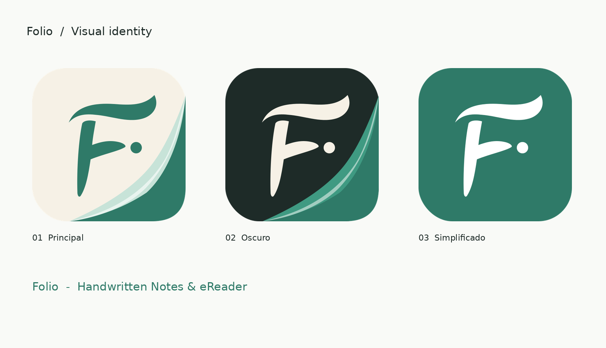

# Folio brand kit

Version 1.0, October 2026. The full guide is in Spanish: [`docs/GUIA_DE_MARCA.md`](docs/GUIA_DE_MARCA.md) and [`docs/Folio_Guia_de_Marca.pdf`](docs/Folio_Guia_de_Marca.pdf). An English summary is on the docs site ([Brand](../../apps/docs/src/content/docs/brand.md)).

| Folder | What |
|---|---|
| `svg/` | Vector masters: primary, dark and flat icons, symbol only (sage, ink, white), monochrome, lockups, Play Store full bleed |
| `png/` | Icons at 48, 96, 192, 512 and 1024 px, lockups, Play Store 512 |
| `android/res/` | Adaptive launcher icon (flat version) with monochrome layer, plus legacy mipmaps |
| `docs/` | Brand guide (Markdown and PDF) |
| `preview/` | Variant sheet |
| `legacy/` | The earlier generated concepts (A, B, C) and their Python generator; kept for reference, no longer used |

## Where the app uses it

- **Launcher icon:** the primary icon (sage F on cream paper with the folded corner). The adaptive background is cream; the foreground draws the fold and the F, mapped to the 72 dp visible area with the fold running past the edge. The monochrome layer (Android 13 themed icons) is the white F from the kit, scaled to 0.7 so it stays inside the 66 dp safe circle. The legacy mipmaps are rendered from `png/folio-icon-primary-512.png`. The flat icon (white F on sage) is kept for the iOS icon and the Play Store image.
- **In-app marks:** `apps/mobile/shared/src/commonMain/composeResources/drawable/folio_symbol.xml` (sidebar) and `folio_icon_primary.xml` (About), drawn from `svg/folio-symbol-sage.svg` and `svg/folio-icon-primary.svg`.
- **Colours and type:** `FolioBrand` and `folioTypography()` in `apps/mobile/shared/src/commonMain/kotlin/com/allient/folio/FolioBrand.kt`. Geist is bundled under the SIL Open Font License.
- **Docs site:** `apps/docs/src/styles/brand.css`, logo `folio-icon-primary.svg`, favicon `folio-symbol-sage.svg`.

When the kit changes, copy the new files here, then repeat the steps above.
